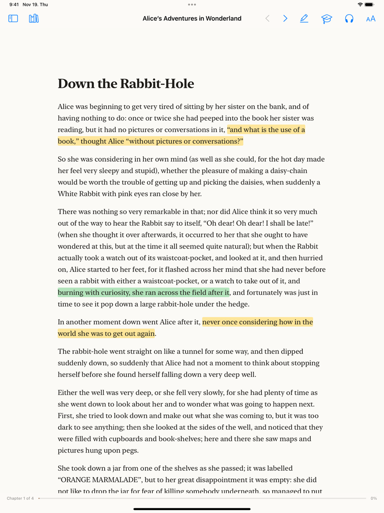
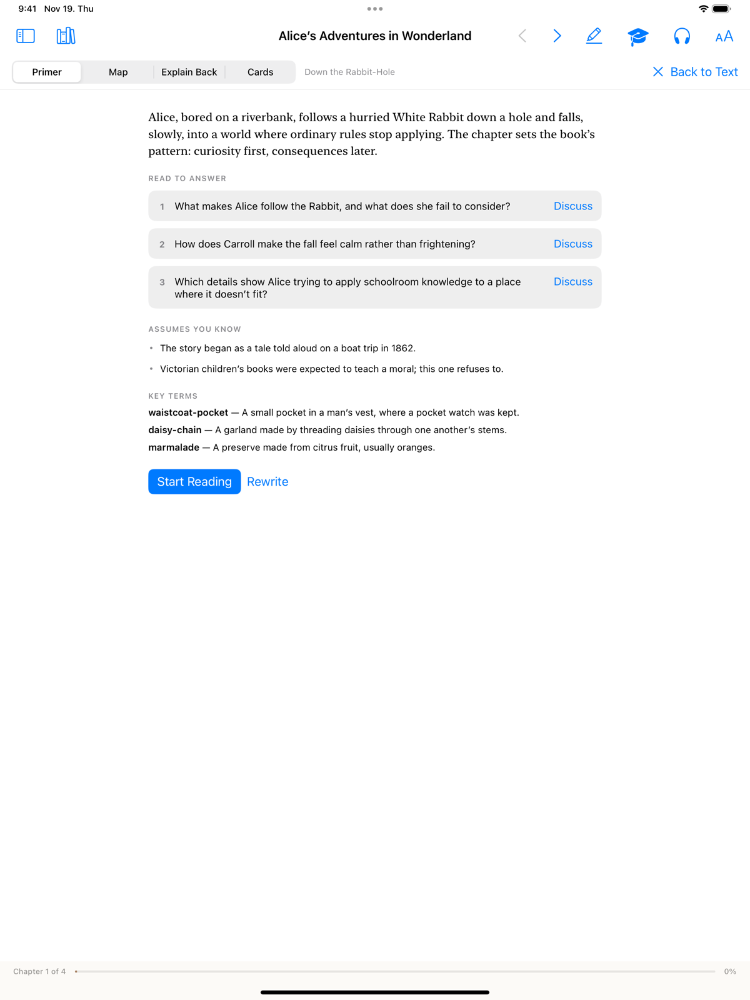
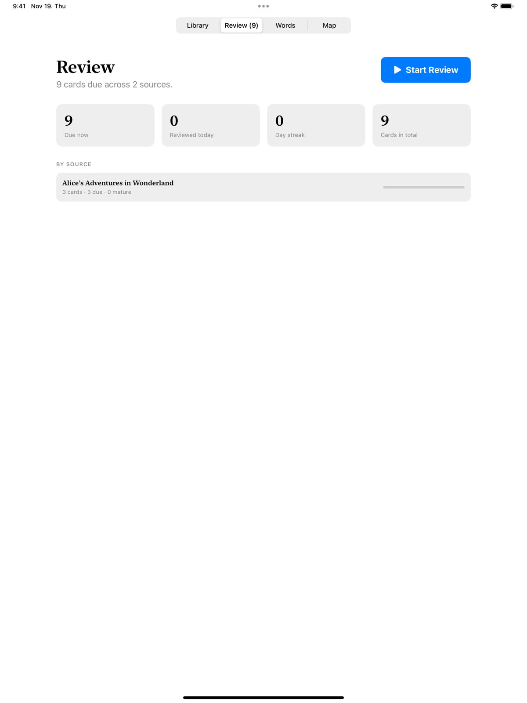

<p align="center">
  
</p>

<h1 align="center">Folio</h1>

<p align="center">
  A reader for Mac and iPad that helps you remember what you read.
</p>

<p align="center">
  <a href="https://github.com/voising/ebook-reader/releases/latest/download/Folio.zip"><b>Download for Mac</b></a>
  &nbsp;·&nbsp;
  <a href="https://foliomac.app">foliomac.app</a>
  &nbsp;·&nbsp;
  <a href="#build-from-source">Build from source</a>
</p>



Folio opens EPUBs, PDFs, web articles and YouTube transcripts. What you highlight becomes concept
maps, flashcards and a word list, and it comes back for review just before you would have
forgotten it. The AI is Claude, through the Claude Code you already have on your Mac. There is no
Folio account and no Folio server.

## What it does

**Reading**

- EPUB and PDF, with paper, sepia and night themes, and your choice of font, size, spacing and width.
- Highlights in five colours, a note per book, and everything copied out as Markdown in one click.
- Double-click a word for the dictionary entry, then Claude's reading of it in that sentence. The word is kept in your list.
- Search inside the book, and a table of contents that follows where you are.
- Listen to the chapter, with a highlight that follows the sentence being read.
- Paste a link: an article is reduced to its text and pictures, a YouTube video becomes its transcript with the player above it.

**Studying**

| | |
|---|---|
| **Primer** | Before you read: what the chapter covers, the questions to read for, and the terms it assumes. |
| **Map** | The chapter's ideas as a diagram, with a line for each connection between them. |
| **Explain Back** | Write what you understood. You get a score, what you got right and what you missed. |
| **Cards** | Flashcards from the chapter and from your highlights, on a spaced-repetition schedule. |

- **Review** gathers the cards due across every book, with your streak and the sections worth re-reading.
- **Ask** answers questions across your whole library and says where each point comes from.
- **Map** joins the concept maps of every book, linking ideas that appear in more than one.
- **Catch me up** recaps where you left off when you come back to a book.

**On iPad**

- Reads, highlights, listens and reviews; what your Mac generated arrives through iCloud.
- With AirPods in, a nod turns the page. It can be turned off under the text settings.
- Double-tap in landscape to move up a screen; tap with three fingers to trim a PDF's margins.

<p>
  
  
</p>

## Install

1. Download [Folio.zip](https://github.com/voising/ebook-reader/releases/latest/download/Folio.zip), unzip it and move Folio to Applications.
2. This build is not notarized by Apple yet, so macOS will refuse to open it the first time. Open
   it once, then go to System Settings › Privacy & Security and choose **Open Anyway**. Or clear the
   flag from Terminal:

   ```sh
   xattr -dr com.apple.quarantine /Applications/Folio.app
   ```

The iPad app is not on the App Store. You can [build it yourself](#build-from-source).

### Requirements

| | |
|---|---|
| macOS 14 or later | Apple silicon or Intel. |
| [Claude Code](https://claude.com/claude-code) | For the chat and all generated study material. Install it, sign in, and make sure `claude` is on your `PATH`. Folio runs it for you. |
| `yt-dlp` (optional) | Only for importing YouTube videos: `brew install yt-dlp`. |
| OpenAI API key (optional) | Only for the more natural reading voice. The built-in system voice needs nothing and works offline. |

Without Claude Code, Folio still works as a reader: highlights, notes, search, the word list with
dictionary definitions, listening, articles and review.

## Your data

- Everything is stored as plain JSON files, next to your books. Nothing goes to a Folio server.
- The downloadable build keeps its data in a `Folio` folder in iCloud Drive, or in
  `~/Library/Application Support/Folio/Folio` if iCloud Drive is off.
- A build signed with your own Apple developer team uses the app's iCloud container, which is what
  the Mac and iPad apps sync through.
- Text you ask Claude about goes to Claude through your own Claude Code session. Text read aloud
  with the OpenAI voice goes to OpenAI and is billed to your key; the system voice stays on the device.

## Keyboard

| Keys | Action |
|---|---|
| `←` `→` or `Space` | Turn one screen |
| `⌘[` `⌘]` | Previous and next chapter |
| `⌘F`, `⌘G` | Find in the book, find next |
| `⇧⌘H` | Highlight the selection |
| `⇧⌘K` | Ask Claude about the selection |
| `⌘J` | Ask Claude |
| `⌥⌘1` – `⌥⌘4` | Primer, Map, Explain Back, Cards |
| `⌥⌘0` | Back to the text |
| `⌥⌘N` | Show the book's note |
| `⌥⌘P` | Listen to the chapter |
| `⇧⌘R` | Review due cards |
| `⇧⌘L` | Back to the library |
| `⌘O`, `⇧⌘Y` | Open a file, add a link |
| `⌘+` `⌘−` `⌘0` | Zoom the page or the text |

## Build from source

You need Xcode 16 or later.

```sh
git clone https://github.com/voising/ebook-reader.git
cd ebook-reader
./build.sh --adhoc --run
```

`--adhoc` builds from `Package.swift` with no developer account. It is the same kind of build as
the download.

To sync between a Mac and an iPad, build the signed apps from `Folio.xcodeproj`:

1. Set your own team in `project.yml` (`DEVELOPMENT_TEAM`), and your own bundle and iCloud
   container identifiers there, in `Support/*.entitlements` and in `CloudStore.containerID`.
2. Regenerate the project with `xcodegen`.
3. Run `./build.sh` for the Mac app, or open the project and run the `Folio-iOS` scheme on your iPad.

Run the tests with:

```sh
swift test --skip Live
```

The `Live` tests call Claude and YouTube for real, so they are left out by default.

## How the code is laid out

| Path | What is in it |
|---|---|
| `Sources/Folio` | The whole app, shared by Mac and iPad. `Platform.swift` holds the differences. |
| `Sources/Folio/ReaderScripts.swift` | The CSS and JavaScript injected into each EPUB chapter: highlights, selection bar, search. |
| `Sources/Folio/Chat.swift` | Runs the `claude` command and streams its answer. |
| `Sources/Folio/Storage.swift`, `Merging.swift` | The synced files, and how two devices' edits are merged. |
| `Tests/FolioTests` | Unit tests for merging, scheduling, parsing and import. |
| `website` | The static site at foliomac.app, deployed with `npx wrangler deploy`. |

## Licence

[MIT](LICENSE)
